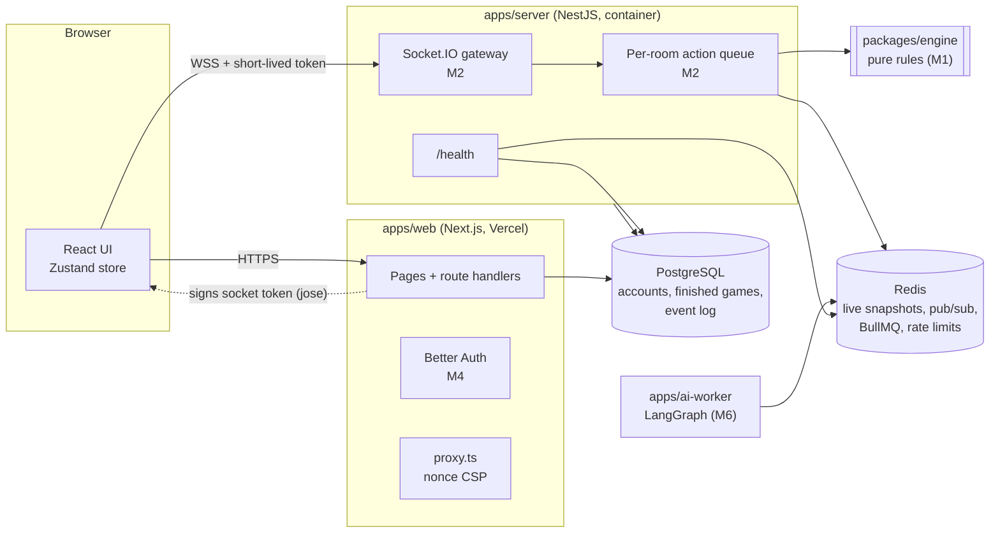
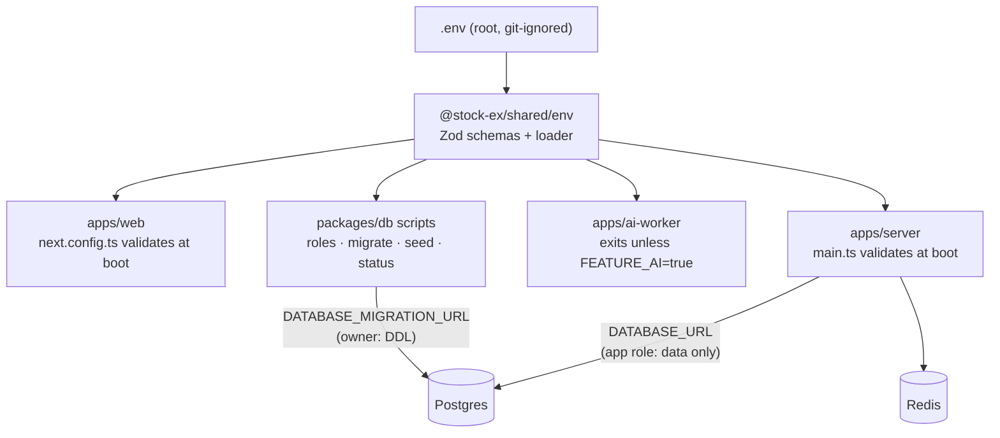

# Architecture

Updated each milestone. Diagrams are Mermaid (GitHub renders them).

## System overview

**Rules of the road**

- The browser only ever sends *intents*. The game server validates, authorizes, applies them through the engine and broadcasts per-player projections.
- Only the game server reads or writes live game state. Hidden cards, deck order and the seed never leave it before they should.
- The engine is a pure library: the server, the simulator and (later) the replay viewer all call the same functions.

## Milestone 0: what exists today

| Package | Builds to | Consumed by |
|---|---|---|
| `@stock-ex/config` | (source: JSON/JS/CSS presets) | every workspace |
| `@stock-ex/shared` | `dist/` via `tsc` | web, server, worker, db |
| `@stock-ex/db` | `dist/` via `tsc` | server (and web in M4) |
| `@stock-ex/engine` | `dist/` via `tsc` | server (M2), web replay viewer (M4) |

Turborepo runs `build` for dependencies before `dev`, `lint`, `typecheck` and `test` (`dependsOn: ["^build"]`), and `pnpm dev` keeps the packages rebuilding with `tsc --watch`.
