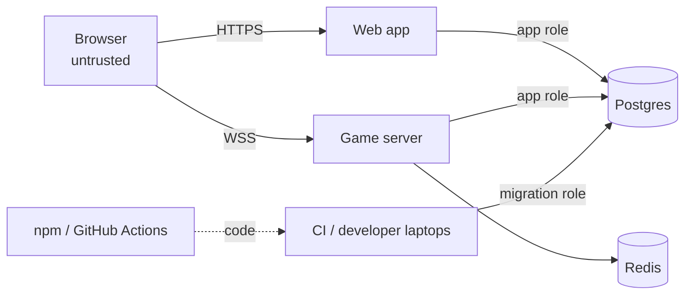

# Threat model

**Version:** M0 (2026-10-26). Updated at the end of every milestone.

## What we protect

| Asset | Why it matters |
|---|---|
| Hidden game information (hands, deck order, seed) | Leaking it breaks fairness, the core of the game |
| Game integrity (cash, holdings, turn order) | Double-spends or out-of-turn moves ruin games |
| Account data (from M4): email, password hash, Google ID | Personal data under DPDP / GDPR |
| Secrets (auth secret, socket token secret, DB/Redis passwords) | Unlock everything above |
| Availability of the game server | Live games are lost if it falls over |
| The repository and CI pipeline | A malicious change could reach production |

## Who might attack

Curious or cheating players (most likely), spammers and griefers in chat, opportunistic bots (credential stuffing, sign-up spam), supply-chain attackers via npm packages or GitHub Actions, and our own mistakes (committed secrets, debug tools left on).

## Trust boundaries

## STRIDE by boundary

| Boundary | Threat | Control | OWASP 2025 | Status |
|---|---|---|---|---|
| Browser → web | XSS via injected script | Nonce CSP with `strict-dynamic`, React escaping, `dangerouslySetInnerHTML` banned by lint | A05 | ✅ M0 |
| Browser → web | Clickjacking | `frame-ancestors 'none'`, `X-Frame-Options: DENY` | A02 | ✅ M0 |
| Browser → web | Third-party frames | Only `https://challenges.cloudflare.com` (Turnstile) may be framed (`frame-src`) | A02 | ✅ M4 |
| Browser → web auth (/api/auth/*) | Password guessing, credential stuffing | Better Auth rate limits stored in Postgres: sign-in 5/min, sign-up 5/10 min, reset requests 3/15 min, verification resends 3/5 min per IP; scrypt hashing; one generic "email and password don't match" message | A07 | ✅ M4 |
| Browser → web auth | Sign-up spam and email bombing | Cloudflare Turnstile on sign-up and reset requests, verified server-side; email verification before any session | A07 | ✅ M4 |
| Browser → web auth | Under-18 accounts | 18+ flag required by a server hook (not just the form); social accounts confirm on /account; timestamp stored | (spec 8) | ✅ M4 |
| Browser → web auth → Google | Pre-account takeover (attacker registers a victim's email with a password, victim later uses Google) | Accounts are linked only when Google says the email is verified **and** the local account has confirmed its email (`requireLocalEmailVerified`); different emails never link | A07 | ✅ M4 |
| Browser → web auth → Google | Login CSRF / forged OAuth callback | Better Auth signs a one-time `state` (stored in Postgres) plus PKCE on every sign-in; unknown or reused state is rejected; `/sign-in/social` limited to 10/min per IP | A01/A07 | ✅ M4 |
| Web → Postgres | Leaked DB dump exposes Google tokens | OAuth access/refresh tokens encrypted at rest (`encryptOAuthTokens`); provider photo URL not stored | A04 | ✅ M4 |
| Browser → web auth | Account probing (which emails exist) | Sign-up and reset requests answer the same either way; the real owner gets an email instead | A07 | ✅ M4 |
| Browser → web auth | CSRF on auth endpoints | Better Auth rejects POSTs whose Origin isn't `WEB_URL` (tested: 403); httpOnly SameSite=Lax cookies, Secure in production | A01 | ✅ M4 |
| Browser → web auth | Stolen session after a password reset | All sessions revoked on reset; "sign out on every device" on /account; server-side sign-out | A07 | ✅ M4 |
| Web → SMTP | Links or addresses leak via logs | Email errors log only an error code; dev console masks the address; the dev outbox `.dev-mail/` is git-ignored and used only without SMTP outside production | A09 | ✅ M4 |
| Web → SMTP | Password sent in clear | `requireTLS` on port 587, TLS from the start on 465 | A04 | ✅ M4 |
| Browser → server | Cross-origin calls from other sites | CORS allowlist = `WEB_URL` only; sockets: `allowRequest` refuses any other Origin before the WebSocket upgrade, and the auth middleware checks it again | A02 | ✅ M0 (HTTP), M2 (sockets) |
| Browser → server | Request flooding | HTTP: `@nestjs/throttler` 120 req/min/IP. Sockets: 40 connections/min per IP and 120 events/10 s per user (Redis, shared by all instances), 60 events/10 s per socket (in memory); over the limit the event is refused with `rate_limited`, and a socket sending twice its limit is disconnected. Chat and room limits come with those slices | A06 | ✅ M0 (HTTP), M2 (sockets) |
| Browser → server | Oversized or malformed socket messages | `maxHttpBufferSize` 16 KB; WebSocket transport only; every payload Zod-checked in its handler, answered with a typed `bad_request` | A05/A06 | ✅ M2 |
| Browser → server | Spoofed identity in payloads | Identity only from the verified socket token, checked on every connection and reconnection and stored in `socket.data.identity`; handlers never read identity from a payload | A01/A07 | ✅ M2 |
| Browser → server | Spoofed client IP to dodge limits | `X-Forwarded-For` ignored unless `TRUST_PROXY=true`, then only its last entry (the one our proxy added) | A06 | ✅ M2 |
| Browser → web (`/api/socket-token`) | Another site obtains a token for a visitor | Origin must equal `WEB_URL` (403 otherwise); token only in the response body, which other sites can't read; `Cache-Control: no-store` | A01 | ✅ M2 |
| Browser → web (`/api/socket-token`) | Forged or stolen socket token | HS256 with the 32-byte `SOCKET_TOKEN_SECRET`, algorithm pinned (no `alg: none`), issuer + audience checked, 5-minute lifetime enforced from `iat` as well as `exp`, Zod-checked claims, never written to storage or logs | A04/A07 | ✅ M2 |
| Browser → web (`/api/socket-token`) | Guest takes over an account's seat, or another guest's | Guest ids are 128 random bits with a `g_` prefix that account ids may never use; kept in an httpOnly, SameSite=Lax cookie (`__Host-` and Secure in production) | A01 | ✅ M2 |
| Browser → web (`/api/socket-token`) | Token-request flooding | Body capped at 256 bytes and Zod-checked; a token is useless without a connection, and the game server allows 40 connections/min per IP | A06 | ✅ M2 |
| Browser → server | Reading hidden cards | `projectForPlayer` is the only output path; leak tests | A01 | ⏳ M1/M2 |
| Browser → server | Race to double-spend | Per-room queue + `stateVersion` + idempotency keys | A06 | 🟡 M2: room changes run one at a time per room (in-process queue) and are saved with a Redis compare-and-set, so two servers can't both take the last seat (tested across two instances). `stateVersion` and idempotency keys arrive with game actions |
| Browser → server (rooms) | Guessing room codes to join private games | 5 characters from a 29-letter alphabet picked with `crypto.randomInt` (~20 million codes); joining is rate-limited with every other event; codes expire with the room | A01 | ✅ M2 |
| Browser → server (rooms) | Acting for someone else (kick, seat changes) | Every room event uses only `socket.data.identity`; payloads carry a room code or an opaque per-room member id, never an account or guest id; only the host may kick, and not themselves | A01 | ✅ M2 |
| Browser → server (rooms) | Learning other players' account or guest ids | Room broadcasts carry display names and random per-room member ids only; ids stay in the server's Redis copy | A01 | ✅ M2 |
| Browser → web (`/room/<code>`) | Room pages indexed, or a crafted code injecting content | Code checked against the room-code schema before anything renders (not-found otherwise); `noindex, nofollow`; all room text comes from the server's `room:state` and is rendered by React, never as HTML | A03/A05 | ✅ M2 |
| Browser → server (rooms) | Room spam filling Redis | 20 new rooms/min per person; rooms expire after `ROOM_TTL_SECONDS` without activity and are deleted when the last member leaves; spectators capped at 10 | A06 | ✅ M2 |
| Server → client | Error details leak internals | Global exception filter returns `{code, message}`; 5xx messages hidden | A10 | ✅ M0 |
| Apps → Postgres | SQL injection | Drizzle parameterised queries; DDL quoting via `format(%I, %L)` | A05 | ✅ M0 |
| Apps → Postgres | Compromised app alters schema | App role has data privileges only; healthcheck verifies | A01/A08 | ✅ M0 |
| Apps → Redis | Unauthenticated access | `requirepass`, bound to 127.0.0.1 locally | A02 | ✅ M0 |
| Logs | Secrets / PII in logs | pino redaction of auth headers, cookies, passwords, tokens, emails (tested) | A09 | ✅ M0 |
| Config | App runs with missing/weak secret | Zod env validation at boot; secrets ≥ 32 bytes; CHANGE-ME rejected | A02/A04 | ✅ M0 |
| Repo | Secret committed | gitleaks pre-commit (fails closed) + CI scan of new commits | A03/A08 | ✅ M0 |
| Repo | Malicious dependency / action | Lockfile + `--frozen-lockfile`, pinned versions, install scripts blocked except approved, Dependabot, `pnpm audit`, dependency review, actions pinned to SHAs | A03 | ✅ M0 |
| Repo | Unreviewed change on `main` | Ruleset: PR + 1 approval + green checks (owner applies, see CONTRIBUTING) | A08 | ⏳ owner |
| Claude Code | AI reads secrets | `.claude/settings.json` deny rules for `.env*` (except `.env.example`) | A02 | ✅ M0 |

## Accepted risks (M0)

- Local development uses HTTP on localhost; HTTPS/HSTS apply in staging/production.
- `'unsafe-eval'` and inline styles are allowed in **development only** (Next.js dev tooling needs them).
- The production Docker image is not yet slimmed (it contains dev dependencies); fixed before M7.

## Next update (M1)

Engine-level threats: predictable shuffles (seeded PRNG with a server-generated 256-bit seed), state mutation on rejected actions (all-or-nothing tests), projection leaks (JSON-scan tests).
