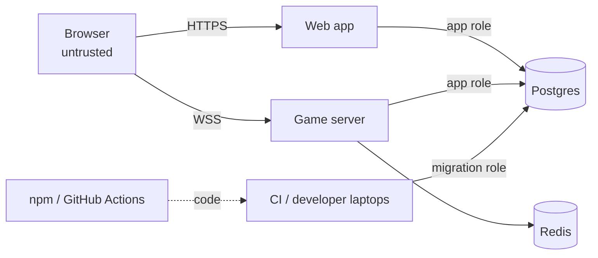

# Threat model

**Version:** M0 (2026-10-26). Updated at the end of every milestone.

## What we protect

| Asset | Why it matters |
|---|---|
| Hidden game information (hands, deck order, seed) | Leaking it breaks fairness, the core of the game |
| Game integrity (cash, holdings, turn order) | Double-spends or out-of-turn moves ruin games |
| Account data (from M4): email, password hash, Google ID | Personal data under DPDP / GDPR |
| Secrets (auth secret, socket token secret, DB/Redis passwords) | Unlock everything above |
| Availability of the game server | Live games are lost if it falls over |
| The repository and CI pipeline | A malicious change could reach production |

## Who might attack

Curious or cheating players (most likely), spammers and griefers in chat, opportunistic bots (credential stuffing, sign-up spam), supply-chain attackers via npm packages or GitHub Actions, and our own mistakes (committed secrets, debug tools left on).

## Trust boundaries

## STRIDE by boundary

| Boundary | Threat | Control | OWASP 2025 | Status |
|---|---|---|---|---|
| Browser → web | XSS via injected script | Nonce CSP with `strict-dynamic`, React escaping, `dangerouslySetInnerHTML` banned by lint | A05 | ✅ M0 |
| Browser → web | Clickjacking | `frame-ancestors 'none'`, `X-Frame-Options: DENY` | A02 | ✅ M0 |
| Browser → server | Cross-origin calls from other sites | CORS allowlist = `WEB_URL` only | A02 | ✅ M0 (HTTP); sockets M2 |
| Browser → server | Request flooding | `@nestjs/throttler` 120 req/min/IP on HTTP; socket limits in M2 | A06 | ✅ M0 (HTTP) |
| Browser → server | Spoofed identity in payloads | Identity only from verified socket token | A01/A07 | ⏳ M2 |
| Browser → server | Reading hidden cards | `projectForPlayer` is the only output path; leak tests | A01 | ⏳ M1/M2 |
| Browser → server | Race to double-spend | Per-room queue + `stateVersion` + idempotency keys | A06 | ⏳ M2 |
| Server → client | Error details leak internals | Global exception filter returns `{code, message}`; 5xx messages hidden | A10 | ✅ M0 |
| Apps → Postgres | SQL injection | Drizzle parameterised queries; DDL quoting via `format(%I, %L)` | A05 | ✅ M0 |
| Apps → Postgres | Compromised app alters schema | App role has data privileges only; healthcheck verifies | A01/A08 | ✅ M0 |
| Apps → Redis | Unauthenticated access | `requirepass`, bound to 127.0.0.1 locally | A02 | ✅ M0 |
| Logs | Secrets / PII in logs | pino redaction of auth headers, cookies, passwords, tokens, emails (tested) | A09 | ✅ M0 |
| Config | App runs with missing/weak secret | Zod env validation at boot; secrets ≥ 32 bytes; CHANGE-ME rejected | A02/A04 | ✅ M0 |
| Repo | Secret committed | gitleaks pre-commit (fails closed) + CI scan of new commits | A03/A08 | ✅ M0 |
| Repo | Malicious dependency / action | Lockfile + `--frozen-lockfile`, pinned versions, install scripts blocked except approved, Dependabot, `pnpm audit`, dependency review, actions pinned to SHAs | A03 | ✅ M0 |
| Repo | Unreviewed change on `main` | Ruleset: PR + 1 approval + green checks (owner applies, see CONTRIBUTING) | A08 | ⏳ owner |
| Claude Code | AI reads secrets | `.claude/settings.json` deny rules for `.env*` (except `.env.example`) | A02 | ✅ M0 |

## Accepted risks (M0)

- Local development uses HTTP on localhost; HTTPS/HSTS apply in staging/production.
- `'unsafe-eval'` and inline styles are allowed in **development only** (Next.js dev tooling needs them).
- The production Docker image is not yet slimmed (it contains dev dependencies); fixed before M7.

## Next update (M1)

Engine-level threats: predictable shuffles (seeded PRNG with a server-generated 256-bit seed), state mutation on rejected actions (all-or-nothing tests), projection leaks (JSON-scan tests).
